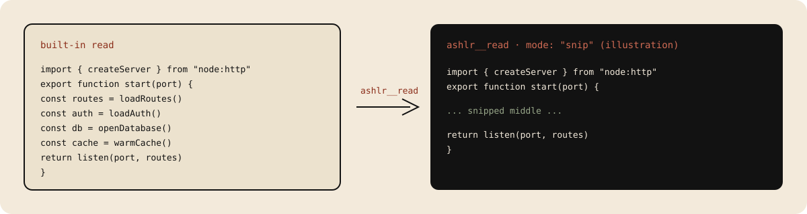
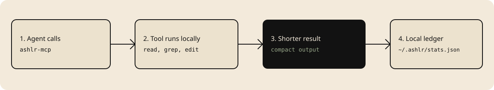
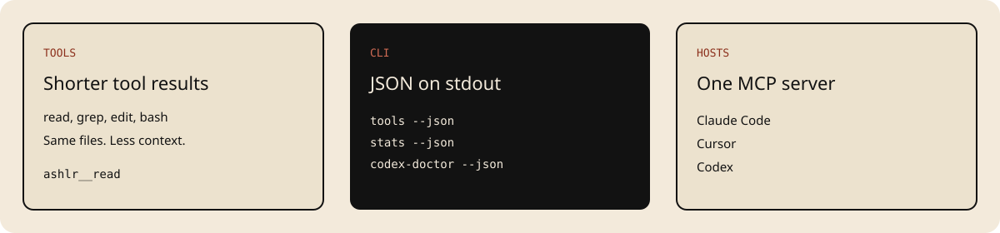

# ashlr-plugin

> **Install with npm, call the CLI with --json, and register the ashlr-mcp server.**

ashlr-plugin is an open source efficiency layer for coding agents. It gives Claude Code, Codex, Cursor, and other MCP hosts shorter file, search, edit, and shell results, then records the difference in a local ledger.

## Get started

Requires Node.js and Bun 1.3 or newer on PATH. No account required.

1. Install the CLI and MCP server:

<!-- fresh:begin install -->
```bash
npm install -g ashlr-plugin@1.38.7
```
<!-- fresh:end -->

2. Run `ashlr-plugin tools --json`. You should see a JSON object with `count` and a `tools` list, including `ashlr__read` and `ashlr__grep`.
3. Add the [MCP server configuration for your host](#mcp-server), then restart the host so it loads the tools.
4. Ask your agent to read `README.md` with `ashlr__read`. Run `ashlr-plugin stats --json` to see the local ledger; `lifetime.calls` increases after recorded tool use. An unused install returns an empty ledger.

Agents spend their context on tool output. Shorter results leave more room for the task. On the 2026-10-17 reference run, reads were about 75% smaller and greps about 27% smaller per call. That is not a whole-session total. The same run's per-repo means were about 60% on vercel/ai, about 63% on pandas, and about 55% on tokio. Reproduce it with `bun run scripts/run-benchmark.ts --compare`. [Methodology](docs/benchmarks.md).

The local plugin is MIT licensed. No account required. Telemetry is off unless you opt in (`ASHLR_TELEMETRY=on`): opt-in telemetry only. It ships 54 MCP tools and the full slash-command catalog.

Agent index: [llms.txt](llms.txt). Runnable reference: [llms-full.txt](llms-full.txt). Rendered docs: [llms.txt](https://plugin.ashlr.ai/llms.txt) and [llms-full.txt](https://plugin.ashlr.ai/llms-full.txt).

<!-- fresh:begin version-badge -->
[](https://www.npmjs.com/package/ashlr-plugin/v/1.38.7)
<!-- fresh:end -->
[](https://github.com/ashlrai/ashlr-plugin/actions/workflows/ci.yml?query=branch%3Amain+event%3Aschedule)
[](./LICENSE)
[](https://github.com/ashlrai/ashlr-plugin)



This illustrates one read mode. By default, large supported JavaScript and TypeScript files can instead return an AST skeleton; other reads may return compacted or summarized content. `mode: "snip"` selects head-and-tail compaction. See the [tool catalog](site/content/docs/tools/index.mdx).

`ashlr__orient` gathers file snippets for repository questions and keeps non-BMP characters intact when truncating a snippet at its per-file limit.

## Install

The npm install above provides the CLI and MCP server. Use the plugin options below for host-specific commands, skills, hooks, and the status line.

Missing a skill, command or hook? Run `ashlr-plugin doctor` for file checks and repair steps. Add `--json` for agents.

To diagnose a prospective recut using local Git refs, run `ashlr-plugin recut-plan --base origin/main` from the repository. It prints a JSON plan with the resolved commits, merge base, status, conflicting paths, and a suggested next step. The head defaults to `HEAD`; add `--head <ref>` to compare another ref, and fetch missing refs separately before retrying. A clean or conflicting diagnosis exits 0, while unavailable refs or a missing common ancestor exit 2. The command does not change branches or the working tree.

`codex-doctor` reports invalid JSON separately from missing configuration files; its JSON report includes parse errors. `ashlr-plugin version` prints the version as text. `ashlr-plugin mcp` starts the stdio router. From a checkout of this repo, the same commands are `bun run scripts/cli.ts <subcommand>`.

Claude Code plugin (slash commands, redirects, and the status line). This clones the plugin into the Claude marketplace cache. It does not install the global npm bin:

```bash
curl -fsSL https://plugin.ashlr.ai/install.sh | bash
```

Then, inside Claude Code:

```
/plugin marketplace add ashlrai/ashlr-plugin
/plugin install ashlr@ashlr-marketplace
/reload-plugins
```

Codex plugin:

```bash
codex plugin marketplace add ashlrai/ashlr-plugin
codex plugin add ashlr@ashlr-marketplace
ashlr-plugin codex-doctor --json
```

Windows (PowerShell):

```powershell
irm https://raw.githubusercontent.com/ashlrai/ashlr-plugin/main/docs/install.ps1 | iex
```

### Machine output

Every `ashlr-plugin` command that takes `--json` prints one JSON object whose first key is `schema`, for example `"schema": "ashlr-plugin.tools.v1"`. The name is `ashlr-plugin.<command>.v1`; check it before reading the rest. Fields are only added within `v1`; a breaking change gets `v2`. `stats --json` with a `--session` or `--tool` that has no data prints `{"schema": "ashlr-plugin.stats.v1", "value": null}`. Text output without `--json` is unchanged.

## MCP server

After the npm install, `ashlr-mcp` is on PATH. Paste one snippet. Do not edit a path.

Claude Code, project file `.mcp.json`:

```json
{
  "mcpServers": {
    "ashlr": {
      "command": "ashlr-mcp",
      "args": [],
      "env": {
        "ASHLR_MCP_HOST": "claude-code"
      }
    }
  }
}
```

Cursor, project file `.cursor/mcp.json`:

```json
{
  "mcpServers": {
    "ashlr": {
      "command": "ashlr-mcp",
      "args": [],
      "env": {
        "ASHLR_MCP_HOST": "cursor"
      }
    }
  }
}
```

Codex, add this block to `~/.codex/config.toml`. It matches `ashlr-plugin codex-install --dry-run --json`:

```toml
[mcp_servers.ashlr]
command = "ashlr-mcp"
args = []
cwd = "."
env = { ASHLR_MCP_HOST = "codex-cli", ASHLR_CODEX_HOOK_MODE = "nudge" }
```

Goose and other hosts: [ports/README.md](ports/README.md) and [docs/multi-host-mcp.md](docs/multi-host-mcp.md).

## How it works



1. The host starts `ashlr-mcp` over stdio.
2. The agent calls `ashlr__read`, `ashlr__grep`, `ashlr__edit`, or `ashlr__bash` instead of the noisy built-in.
3. The tool performs its operation and returns a compact result. File and search tools operate within the allowed project roots; `ashlr__grep` requires ripgrep (`rg`) on PATH.
4. Recorded savings are written to `~/.ashlr/stats.json`. Read them with `ashlr-plugin stats --json` or `ashlr__savings`.

On Claude Code the PreToolUse hooks redirect built-in tools by default; set `ASHLR_HOOK_MODE=nudge` for suggestions only or `off` to disable them. Codex nudges and does not force a redirect. Cursor calls the MCP tools directly.

## Tool calls

Arguments below match the tool catalog. Run them only after the MCP server is connected. `ashlr__read` and `ashlr__grep` do not modify files.

Read this README:

```json
{
  "name": "ashlr__read",
  "arguments": {
    "path": "README.md"
  }
}
```

Search the server source:

```json
{
  "name": "ashlr__grep",
  "arguments": {
    "pattern": "registerTool",
    "cwd": "servers"
  }
}
```

Recover full file content with `bypassSummary: true`. For a focused read without summarization, use a 1-based inclusive range:

```json
{
  "name": "ashlr__read",
  "arguments": {
    "path": "README.md",
    "startLine": 1,
    "endLine": 20
  }
}
```

If `endLine` is omitted, the range defaults to 200 lines, capped at the file end. See the [read reference](site/content/docs/tools/read.mdx).

Read the ledger:

```json
{
  "name": "ashlr__savings",
  "arguments": {}
}
```

`ashlr__edit` takes `path`, `search`, and `replace`. It writes the file. Use it when you mean to change that file. The full catalog is [site/content/docs/tools](site/content/docs/tools/index.mdx) and, on the web, [plugin.ashlr.ai/docs/tools](https://plugin.ashlr.ai/docs/tools).

## Features



| Need | Call |
|---|---|
| Read a large file | `ashlr__read` |
| Recover full content or specific lines | `ashlr__read` with `bypassSummary: true` or `startLine`/`endLine` |
| Search | `ashlr__grep` |
| Edit without echoing the file | `ashlr__edit` |
| Shell output | `ashlr__bash` |
| Long-running shell commands | `ashlr__bash_start`, `ashlr__bash_tail`, `ashlr__bash_stop`, `ashlr__bash_list` |
| Repo map | `ashlr__tree` or `ashlr__orient` |
| Tests and diffs | `ashlr__test` or `ashlr__diff_semantic` |
| Edit a notebook cell | `ashlr__notebook_edit` |
| GitHub PRs and issues | `ashlr__pr` or `ashlr__issue` |
| Savings | `ashlr__savings` or `ashlr-plugin stats --json` |

### Also registered

| Group | Tools |
|---|---|
| Files | `ashlr__glob` (file globs), `ashlr__ls` (directory listing), `ashlr__write` (write without echo), `ashlr__multi_edit` (atomic edits across files), `ashlr__edit_structural` (AST rename/extract), `ashlr__rename_file` (move and fix imports), `ashlr__search_replace_regex` (bulk regex replace), `ashlr__flush` (write queued edits now) |
| Web and data | `ashlr__webfetch`, `ashlr__websearch`, `ashlr__http`, `ashlr__logs`, `ashlr__sql` |
| Questions | `ashlr__ask` (routes a plain question to the right tool) |
| GitHub | `ashlr__pr_comment`, `ashlr__pr_approve`, `ashlr__issue_create`, `ashlr__issue_close` |
| Genome | `ashlr__genome_propose`, `ashlr__genome_consolidate`, `ashlr__genome_status` |
| Tasks | `ashlr__task_list`, `ashlr__task_get` |
| Fleet | `ashlr__fleet_state`, `ashlr__fleet_events`, `ashlr__fleet_intent`, `ashlr__fleet_session`, `ashlr__fleet_act`, `ashlr__fleet_snapshot`, `ashlr__fleet_direction`, `ashlr__fleet_lanes`, `ashlr__fleet_proposals`, `ashlr__fleet_propose`, `ashlr__fleet_browser`, `ashlr__fleet_resources`, `ashlr__fleet_ghosts`, `ashlr__fleet_dirty_triage` |

54 MCP tools are registered by default. One experimental tool, `ashlr__pipe`, stays off until `ASHLR_PIPE_ENABLE=1`.

## FAQ

### Does an agent need an account?

No account required. `npm install -g` and the MCP snippet are enough for local tools and the ledger.

### Where do file contents go?

The MCP server runs on the machine that started it. Tool results go back to the host, the same way a built-in read would. Telemetry is off unless `ASHLR_TELEMETRY=on`. The contract is [docs/telemetry.md](docs/telemetry.md).

### What does a savings number mean?

It is the difference for one tool call, not the cost of a whole session. The published reference run is [docs/benchmarks.md](docs/benchmarks.md). Your own ledger is `ashlr-plugin stats --json`.

### Which hosts get slash commands?

Claude Code gets slash commands, hook redirects, and the status line. Codex gets the plugin, skills, nudge hooks, and the CLI. Cursor gets the MCP server. The matrix is [docs/multi-host-mcp.md](docs/multi-host-mcp.md).

### What is Pro?

The local plugin is the free product. Pro ($12/month or $120/year) adds cloud summarization and cross-machine stats. Team ($24/user/month, or $20/user/month billed annually, minimum 3) adds a shared encrypted genome. Prices and limits: [docs/pricing.md](docs/pricing.md).

## Star

If this saved context on a real task, star the repo so other people and agents can find it: [github.com/ashlrai/ashlr-plugin](https://github.com/ashlrai/ashlr-plugin).

## Releasing

### Automatic releases

Merge a version bump (`package.json`) to `main` on green. `auto-tag.yml` waits for every required check on that exact commit and creates a missing `v<version>` tag with the ashlr-release App token. `release.yml` then reuses or dispatches canonical full CI for that exact tag before publishing. Qualification requires successful Linux, macOS, and Windows jobs, complete test inventories, and completion receipts from the same run attempt. The fast gate alone does not qualify a release.

Manual, one command each:

```bash
gh workflow run auto-tag.yml -R ashlrai/ashlr-plugin --ref main
gh workflow run release.yml -R ashlrai/ashlr-plugin --ref main -f version=X.Y.Z
```

The first tags the current `main` version if its tag is missing and checks are green. The second qualifies and publishes an existing `vX.Y.Z` tag; `-f tag=vX.Y.Z` is also accepted when `version` is omitted. Dispatch release workflows from `main`. Tags are immutable candidates: if qualification fails and a source fix is needed, create a new version through the sanctioned workflow.

## Release notes

Version history lives in [CHANGELOG.md](CHANGELOG.md).

---

## Status-line

The Claude Code status bar shows savings and other session information.

Install:

```bash
bun run scripts/install-status-line.ts
```

With the sparkline and tips disabled, examples include:

| Example output | Meaning |
|---|---|
| `ashlr · ctx: 50% · session +0 ≈$0.00 · lifetime +1.5K (est.)` | No session savings yet; the lifetime total is estimated. |
| `ashlr · ctx: 92% · session +0 ≈$0.00` | Context usage is available from Claude Code input; the lifetime segment is absent when its selected total is zero. |

Fields are separated by `·`; `+` denotes saved tokens. Counts use `K` for thousands and `M` for millions. Optional fields depend on settings, available data and terminal width.

| Field | Meaning |
|---|---|
| `ashlr` | Identifies the status line. |
| Heartbeat and `7d` sparkline | The heartbeat animates briefly after a save when animation is enabled. Seven cells show daily tokens saved, oldest to newest, for the current and preceding six UTC days, scaled to the largest day. The `7d` label appears above 100 columns. |
| `ctx: 50%` | Context used as a percentage of the limit supplied by Claude Code; hidden when usable input is unavailable. |
| `session ↑+12.3K` | Tokens saved across matching current-session buckets. `↑` (or ASCII `+`) marks a save in the last four seconds; without stats the line may say `waiting for first tool call`, or `collecting…` during early zero-savings use. |
| `≈$0.01` | Estimated session savings in US dollars, using the detected summarizer's input price, an `ASHLR_PRICING_MODEL` override, or main-model pricing when the detected price is zero and no override is set. Values below one cent display as `≈$0.00`. |
| `lifetime +1.2M (est.)` | Local lifetime tokens saved. After ten measured calls, `(API-measured)` instead shows only the measured-call total, which can be lower than the overall estimate. |
| `* 3d streak` | Stored current streak of active days; shown from three days. |
| `☁ 2 machines` | Machine count from the cached cross-machine aggregate for Pro; the cache can be stale. |
| `brief: concise` | Active user-level brief setting; hidden when off. |
| `last: ashlr__read +5.0K [2s ago]` | Age of the latest session save and the highest-saving tool entry in a matching session bucket. The count is that entry's accumulated savings, so the tool and count are a proxy, not necessarily the last call. Shown for up to 60 seconds. |
| `tip: …` or `↑: …` | A rotating usage tip, or an upgrade hint when an apparently free user has saved at least 50,000 session tokens. |

On narrow terminals, fields can be omitted or the line truncated; an absent field does not imply a zero value. See the [status-line documentation](docs/status-line-fields-q8.md) for visibility rules, fallback behavior and stale data.

The optional `statusLine` settings live under the `ashlr` key in `~/.claude/settings.json`. Omitted booleans use the defaults shown here.

| Field | Default | Effect |
|---|---:|---|
| `statusLine` | `true` | Master switch; `false` hides the status line. |
| `statusLineSession` | `true` | Show the current session's saved-token count and cost estimate. |
| `statusLineLifetime` | `true` | Show lifetime saved-token count when it is greater than zero. |
| `statusLineTips` | `true` | Add a rotating tip, or an eligible upgrade nudge, when it fits. |
| `statusLineSparkline` | `true` | Show the 7-day activity sparkline and heartbeat. |
| `statusLineUpgradeNudge` | `true` | Allow the free-tier 50K-session-savings upgrade nudge; set `false` to silence it. |

For example, to hide tips and lifetime totals while keeping session savings:

```json
{
  "ashlr": {
    "statusLineTips": false,
    "statusLineLifetime": false
  }
}
```

The status line is Claude Code-specific. Codex users can inspect savings with `ashlr-plugin stats --json` or the `ashlr__savings` MCP tool.

---

## Provider base URLs

The plugin's own provider calls (the summarizer and token-count calls to Anthropic, the genome reachability probes for Anthropic and OpenAI, and the Ollama checks in `/ashlr-ollama-setup` and `genome-init`) read the usual environment variables and keep their old defaults when none is set:

| Variable | Default | Form |
|---|---|---|
| `ANTHROPIC_BASE_URL` | `https://api.anthropic.com` | root, without `/v1` |
| `OPENAI_BASE_URL` | `https://api.openai.com/v1` | includes `/v1` |
| `OLLAMA_HOST` | `http://localhost:11434` | `host`, `host:port`, `:port` or a full URL |

Trailing slashes are trimmed. Pointing these at a gateway such as a LiteLLM proxy or a Phantom proxy is therefore possible, because the plugin just sends its requests to whatever URL you set. Only the URL handling is covered by tests here; the plugin has not been tested against any specific gateway, and what a gateway does with your keys and requests is documented by that gateway. Not covered: the Ollama probe in the session greeting and the optional `ASHLR_EMBED_URL` embedding endpoint, which keep their own settings.

Under a Phantom session these variables are set for you; see [Plugs into Phantom Secrets](#plugs-into-phantom-secrets).

---

## Plugs into Phantom Secrets

[Phantom Secrets](https://github.com/ashlrai/phantom-secrets) swaps the real keys in a project for scoped `phm_` placeholders and swaps them back at an authenticated local proxy: the agent can use the key but never sees it. The plugin runs inside that boundary with no extra wiring. `phantom exec` hands the child `phm_` placeholders and points `ANTHROPIC_BASE_URL` and `OPENAI_BASE_URL` at `http://127.0.0.1:<port>/<route>/_phantom/<token>/`; the plugin sends whatever key and base URL it is given, so the placeholder flows through unchanged and the proxy does the swap.

```bash
# Hosts run inside the Phantom boundary
phantom exec -- claude
phantom exec -- codex

# Plugin scripts work the same way
phantom exec -- bun run scripts/doctor.ts
phantom exec -- bun run scripts/run-benchmark.ts --validate-tokenizer
```

Inside a session:

- **`/ashlr-doctor` reports it.** A `phantom exec` line shows the proxy port, which provider keys hold `phm_` placeholders, and which base URLs point at the session's proxy (session token redacted). It warns when a `phm_` placeholder sits outside a session, when a placeholder's base URL does not point at the proxy, or when a key is a `phm:` reference. The doctor also lists whether the `phantom` CLI is installed and its version; it runs only `phantom --version` and never reads or reveals secret values.
- **Optional preflight.** `ASHLR_PHANTOM_PREFLIGHT=1` (or `strict`) makes the doctor also run Phantom's value-free `phantom agent doctor --json` and report its verdict as a `phantom preflight` line. See [docs/phantom-preflight.md](docs/phantom-preflight.md).
- **Benchmarks adapt.** `run-benchmark --validate-tokenizer` skips its API sample when the key would not work from that process, and says why.
- **Hard guarantees.** Detection uses variable names, the `phm_` / `phm:` prefixes, and the base URL host and port only. The plugin never resolves `phm:` references, never runs `phantom reveal`, and never prints key values.

The Phantom fleet mod in [`mods/`](mods/README.md) goes further on Claude Code **2.1.309+** with a pinned [Locus](https://github.com/ashlrai/locus) binding and compatible Phantom/Locus CLIs: governed model routing (`phm router select`), a `/top` fleet pane, `/peers`, and person-acknowledged `/send`. `/ashlr-fleet` explains it inside a session. It ships from the git plugin only (the npm package omits `mods/`); the Claude plugin loads its registration through `hooks/hooks.json`, and some of its CLI contracts are still proposals upstream: `mods/README.md` marks what is verified.

The full `phantom exec` contract, including LiteLLM notes and the strict-gateway variables, lives in [docs/PHANTOM-USAGE.md](docs/PHANTOM-USAGE.md). Session detection and the doctor line are covered by `__tests__/phantom-exec.test.ts` and `__tests__/doctor-phantom.test.ts`; the plugin has not been tested against a live Phantom session here.

---

## Commands

Use `ashlr-plugin` in a terminal and slash commands inside Claude Code. MCP hosts call tools through `ashlr-mcp`.

| Task | Terminal | Claude Code |
|---|---|---|
| Start here | [`ashlr-plugin codex-doctor`](docs/command-examples.md#ashlr-plugin-codex-doctor) for Codex diagnostics | [`/ashlr-start`](docs/command-examples.md#ashlr-start) |
| Check savings | [`ashlr-plugin stats --json`](docs/command-examples.md#ashlr-plugin-stats---json) | [`/ashlr-savings`](docs/command-examples.md#ashlr-savings) or [`/ashlr-dashboard`](docs/command-examples.md#ashlr-dashboard) |
| Inspect tools | [`ashlr-plugin tools`](docs/command-examples.md#ashlr-plugin-tools) | [`/ashlr-help`](docs/command-examples.md#ashlr-help) |
| Preview Codex setup | [`ashlr-plugin codex-install --dry-run`](docs/command-examples.md#ashlr-plugin-codex-install---dry-run) | See [multi-host setup](docs/multi-host-mcp.md) |
| Refresh changed genome files | [`ashlr-plugin genome-refresh`](docs/command-examples.md#ashlr-plugin-genome-refresh) | [`/ashlr-genome-loop`](docs/command-examples.md#ashlr-genome-loop) to inspect the automatic loop |
| Decode the status line | See [status-line setup](#status-line) | [`/ashlr-legend`](docs/command-examples.md#ashlr-legend) |

### CLI options

Run `ashlr-plugin --help` for the current command list. Brackets mark optional flags; values in angle brackets are placeholders.

```text
ashlr-plugin stats --json [--session <id>] [--since <YYYY-MM-DD>] [--tool <name>]
ashlr-plugin tools [--json]
ashlr-plugin manifest [--json]
ashlr-plugin mcp
ashlr-plugin codex-start [--json]
ashlr-plugin codex-resume [--json]
ashlr-plugin codex-end [--json]
ashlr-plugin codex-doctor [--json]
ashlr-plugin doctor [--json] [--root <plugin-folder>]
ashlr-plugin codex-install --dry-run [--json]
ashlr-plugin genome-refresh [--json] [--full] [--dry-run] [--quiet] [--debounce <ms>]
ashlr-plugin selftest [--json] [--only <id|command,...>] [--keep-tmp] [--timeout-ms <n>]
ashlr-plugin recut-plan --base <ref> [--head <ref>]
ashlr-plugin version
```

Run `ashlr-plugin doctor` to check installed skills, commands and hooks against the CLI's shipped file manifest. Missing or changed files come with a reinstall step. Use `--root <plugin-folder>` to check a host's cached plugin. It only reads files, works offline, and exits 0 when clean or 1 when repairs are needed. `--json` returns `{ schemaVersion: 1, ok, root, checked, issues: [{ path, status, fix }] }`; `status` is `missing`, `stale` (changed contents), or `unreadable`. `codex-doctor` remains the separate Codex configuration check. Contributors run `bun run doctor:sync` after changing skills, commands or hooks; tests verify the manifest stays current.

`--version` and `-v` alias `version`; `help`, `--help`, and `-h` show usage. `ashlr-plugin --ashlr-handshake` returns launcher capabilities as JSON, even without Bun.

Run `ashlr-plugin manifest` to list every shipped skill and slash command. Add `--json` for `schemaVersion: 1`, the plugin name and version, and `commands` and `skills` arrays with `name`, `description`, and package-relative `path`. Discovery only reads installed files; skills and slash commands run through your host agent.

`stats` filters the savings ledger by session, date, or tool. `codex-start`, `codex-resume`, and `codex-end` print session guidance; `codex-doctor` checks the installation, and `codex-install --dry-run` previews configuration changes. `genome-refresh` refreshes changed files; `--full` rebuilds affected genomes, `--dry-run` previews, `--quiet` suppresses output, and `--debounce` sets the delay in milliseconds. `selftest` checks command entry points; `--only` selects checks, `--keep-tmp` retains fixtures, and `--timeout-ms` sets the timeout in milliseconds. `recut-plan` compares local Git refs without changing the working tree.

See the [complete command reference](docs/commands.md) for every shipped slash command, terminal command, aliases, and source links. Claude Code slash commands are not terminal subcommands. The CLI executable is `ashlr-plugin`; `ashlr` belongs to Ashlr Hub.

### Claude Code slash commands

These are prompt commands, not terminal subcommands. Follow each source link for arguments, prerequisites, and side effects. Team, cloud, and companion CLI commands need their stated setup.

| Command | Purpose |
|---|---|
| [`/ashlr-allow`](commands/ashlr-allow.md) | Allow every Ashlr MCP tool in Claude settings. |
| [`/ashlr-benchmark`](commands/ashlr-benchmark.md) | Measure tool savings on the current project. |
| [`/ashlr-brief`](commands/ashlr-brief.md) | Set response length: lite, standard, or concise. |
| [`/ashlr-budget`](commands/ashlr-budget.md) | Set, inspect, or clear a session budget. |
| [`/ashlr-compact`](commands/ashlr-compact.md) | Inspect stale tool results and plan recompression. |
| [`/ashlr-dashboard`](commands/ashlr-dashboard.md) | Show savings charts; `--by-tool` groups tool usage. |
| [`/ashlr-doctor`](commands/ashlr-doctor.md) | Check install health; `--errors` shows recent errors. |
| [`/ashlr-eco-mode`](commands/ashlr-eco-mode.md) | Toggle extra token-saving behaviors. |
| [`/ashlr-fleet`](commands/ashlr-fleet.md) | Explain the companion Phantom fleet controls. |
| [`/ashlr-genome-init`](commands/ashlr-genome-init.md) | Create local project memory. |
| [`/ashlr-genome-keygen`](commands/ashlr-genome-keygen.md) | Create and register a team encryption keypair. |
| [`/ashlr-genome-loop`](commands/ashlr-genome-loop.md) | Inspect or toggle the genome proposal loop. |
| [`/ashlr-genome-push`](commands/ashlr-genome-push.md) | Upload local genome sections to the team cloud. |
| [`/ashlr-genome-rewrap`](commands/ashlr-genome-rewrap.md) | Refresh team key envelopes as an admin. |
| [`/ashlr-genome-team-init`](commands/ashlr-genome-team-init.md) | Set up an encrypted team genome as an admin. |
| [`/ashlr-handoff`](commands/ashlr-handoff.md) | Prepare context for the next session. |
| [`/ashlr-help`](commands/ashlr-help.md) | Show the in-session command menu. |
| [`/ashlr-hook-timings`](commands/ashlr-hook-timings.md) | Report hook latency and errors. |
| [`/ashlr-leaderboard`](commands/ashlr-leaderboard.md) | Inspect or change public savings sharing; off by default. |
| [`/ashlr-legend`](commands/ashlr-legend.md) | Explain the status line. |
| [`/ashlr-ollama-setup`](commands/ashlr-ollama-setup.md) | Check local Ollama and guide model setup. |
| [`/ashlr-orchestrate`](commands/ashlr-orchestrate.md) | Preview and run a task graph; Pro or Team required. |
| [`/ashlr-orchestrate-status`](commands/ashlr-orchestrate-status.md) | Inspect orchestration runs. |
| [`/ashlr-parallelize`](commands/ashlr-parallelize.md) | Apply one task to several files with sub-agents. |
| [`/ashlr-report-crash`](commands/ashlr-report-crash.md) | Preview or upload one redacted crash report. |
| [`/ashlr-resume`](commands/ashlr-resume.md) | Show the previous session and suggested next steps. |
| [`/ashlr-savings`](commands/ashlr-savings.md) | Show session and lifetime savings. |
| [`/ashlr-selftest`](commands/ashlr-selftest.md) | Probe command entry points in a fixture repo. |
| [`/ashlr-settings`](commands/ashlr-settings.md) | View or change plugin settings. |
| [`/ashlr-spawn`](commands/ashlr-spawn.md) | Run a named delegation pattern. |
| [`/ashlr-start`](commands/ashlr-start.md) | Run the first-session wizard. |
| [`/ashlr-status`](commands/ashlr-status.md) | Check activation and MCP health; `--context` shows context usage. |
| [`/ashlr-team-invite`](commands/ashlr-team-invite.md) | Send a team invitation as an admin. |
| [`/ashlr-tier`](commands/ashlr-tier.md) | Delegate discovery, implementation, and review by model tier. |
| [`/ashlr-tour`](commands/ashlr-tour.md) | Walk through the tools on the current project. |
| [`/ashlr-update`](commands/ashlr-update.md) | Update the git plugin from its remote. |
| [`/ashlr-upgrade`](commands/ashlr-upgrade.md) | Sign in and open Pro or Team checkout. |
| [`/goal`](commands/goal.md) | Plan and advance a goal through the companion Ashlr Hub CLI. |
| [`/loop`](commands/loop.md) | Run the companion Ashlr Hub fleet conductor. |

### Skills

The plugin ships these workflow instructions in `skills/`, the directory declared by the Codex manifest. They guide the agent; they are not CLI subcommands. Follow the source link for activation and supported host behavior.

| Skill | Purpose |
|---|---|
| [`ashlr-brief`](skills/ashlr-brief/SKILL.md) | Shorten prose while preserving code and errors. |
| [`ashlr-codex-doctor`](skills/ashlr-codex-doctor/SKILL.md) | Diagnose Codex packaging and workspace access. |
| [`ashlr-codex-efficient-tools`](skills/ashlr-codex-efficient-tools/SKILL.md) | Choose compact tools in Codex. |
| [`ashlr-codex-genome-refresh`](skills/ashlr-codex-genome-refresh/SKILL.md) | Refresh project memory after architecture changes. |
| [`ashlr-codex-parallel-explore`](skills/ashlr-codex-parallel-explore/SKILL.md) | Split independent exploration questions in Codex. |
| [`ashlr-codex-savings`](skills/ashlr-codex-savings/SKILL.md) | Read savings through the CLI or MCP. |
| [`ashlr-cost-refactor`](skills/ashlr-cost-refactor/SKILL.md) | Refactor with a diff first and batched edits. |
| [`ashlr-efficient`](skills/ashlr-efficient/SKILL.md) | Put answers first and format responses clearly. |
| [`ashlr-genome-author`](skills/ashlr-genome-author/SKILL.md) | Record meaningful architecture decisions. |
| [`ashlr-lean-tools`](skills/ashlr-lean-tools/SKILL.md) | Read once, batch edits, and avoid repeat scans. |
| [`ashlr-search`](skills/ashlr-search/SKILL.md) | Use genome-aware search and combine queries. |

### Hooks

The registered events come from [Claude hooks](hooks/hooks.json) and [Codex hooks](hooks/codex-hooks.json). The manifests link every hook script. Installing only the MCP server does not install host hooks.

| Event | Claude Code | Codex |
|---|---|---|
| `SessionStart` | Initialize session, load memory, and add workflow guidance. | Add tool and workflow guidance. |
| `UserPromptSubmit` | Detect brief-mode requests. | Detect brief-mode requests. |
| `PreToolUse` | Apply policy, budgets, routing, and tool redirects. | Suggest compact tools and report budget usage. |
| `PostToolUse` | Record usage, audit edits, and nudge or queue memory updates. | Record usage and collect genome proposals. |
| `SessionEnd` | Consolidate and sync memory, report hook health, and close stats. | None registered. |
| `PreCompact` | None registered. | Consolidate and sync memory before compaction. |
| `PostCompact` | None registered. | Restore tool guidance after compaction. |
| `SubagentStart` | None registered. | Add response-format guidance. |
| `SubagentStop` | Roll up sub-agent accounting. | Roll up sub-agent accounting. |
| `Stop` | Reconcile turn accounting. | Reconcile turn accounting. |

## Free vs Pro

The free tier is the product: 54 MCP tools, the full slash-command catalog, the full genome scribe loop, and every benchmark included. No account required.

Pro ($12/mo, 7-day trial) adds cloud infrastructure for developers who need it: cross-machine stats sync, hosted embedding retrieval, cloud LLM summarizer (no local Ollama required), and a live auto-updating savings badge. Team ($24/user/mo, min 3) adds shared encrypted team genome, org savings dashboard, policy packs, and SSO.

Run `/ashlr-upgrade` to upgrade, or see [plugin.ashlr.ai/docs/pro/pricing](https://plugin.ashlr.ai/docs/pro/pricing) for the full comparison.

## Architecture

See [plugin.ashlr.ai/docs/contributing/architecture](https://plugin.ashlr.ai/docs/contributing/architecture) for how the tools, hooks, and genome scribe loop fit together. Internal notes: [`docs/architecture.md`](./docs/architecture.md).

## Changelog

See [CHANGELOG.md](./CHANGELOG.md) for version history.

## Part of the Ashlr ecosystem

The Ashlr plugin is one of the open-source tools from [Ashlr](https://ashlr.ai), a forward-deployed engineering company. [Phantom](https://github.com/ashlrai/phantom) and its ecosystem form an autonomous, code-first, agent-native software factory: agents do the engineering, the human sits as a passive board member, and the goal is open source RSI (recursive self-improvement). Each repo is a tool the agents use, and agents maintain each repo.

| Repo | Role |
|---|---|
| [Phantom](https://github.com/ashlrai/phantom) | The engineering agent workbench: one CLI (`phm`), a JSON interface and an MCP gateway that run the agent fleet. |
| [Phantom Secrets](https://github.com/ashlrai/phantom-secrets) | Agents use API keys without seeing them: `phm_` placeholders are swapped back at a local proxy. See [Plugs into Phantom Secrets](#plugs-into-phantom-secrets). |
| **ashlr-plugin** (this repo) | The efficiency layer: shorter tool output for Claude Code, Codex, Cursor and other MCP hosts, with a local savings ledger. |
| [Locus](https://github.com/ashlrai/locus) | Identity pinning: CLI commands, MCP tools and agent sessions are sealed to one pinned account. |
| [Lexicon](https://github.com/ashlrai/lexicon) | A personal voice lexicon that fixes the names speech-to-text gets wrong before they reach the agent. |
| [Ashlr Stack](https://github.com/ashlrai/ashlr-stack) | Configures supported services from the terminal or an agent and records credentials in Phantom Secrets. |
| [Ashlr MD](https://github.com/ashlrai/ashlr-md) | An open-source desktop Markdown app with on-device AI. |

The plugin, Ashlr Stack and Locus share the [companion handshake](docs/ashlr-handshake.md): `ashlr-plugin --ashlr-handshake` prints capabilities and health as JSON, so Phantom and other agents can discover the plugin without parsing `--help`.

Agents work on this repo directly: they branch, commit, open pull requests and merge on green under the rules in [AGENTS.md](AGENTS.md). People are welcome too; see [Contributing](#contributing).

## Contributing

Issues and PRs are welcome. Look for [`good first issue`](https://github.com/ashlrai/ashlr-plugin/labels/good%20first%20issue) to get started, and read [CONTRIBUTING.md](CONTRIBUTING.md). No write access? [Contribute from a fork with your own agent](CONTRIBUTING.md#contribute-from-a-fork-with-your-own-agent): fork, hand the issue to Claude Code or Codex, and open a PR. A maintainer arms auto-merge. Report security problems privately per [SECURITY.md](SECURITY.md).

## License

MIT: [LICENSE](./LICENSE).
