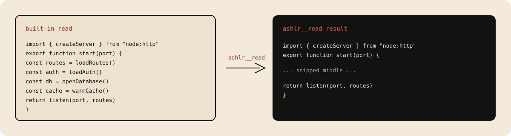
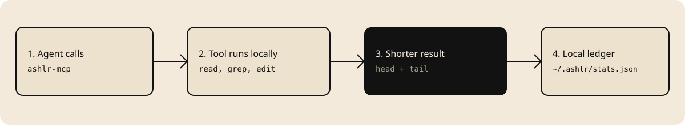
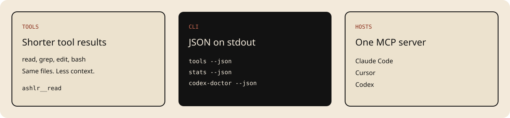

# ashlr-plugin

> **Install with npm, call the CLI with --json, and register the ashlr-mcp server.**

ashlr-plugin is an open source efficiency layer for coding agents. It gives Claude Code, Codex, Cursor, and other MCP hosts shorter file, search, edit, and shell results, then records the difference in a local ledger.

Agents spend their context on tool output. Shorter results leave more room for the task. On the 2026-10-17 reference run, reads were about 75% smaller and greps about 27% smaller per call. That is not a whole-session total. The same run's per-repo means were about 60% on vercel/ai, about 63% on pandas, and about 55% on tokio. Reproduce it with `bun run scripts/run-benchmark.ts --compare`. [Methodology](docs/benchmarks.md).

The local plugin is MIT licensed. No account required. Telemetry is off unless you opt in (`ASHLR_TELEMETRY=on`): opt-in telemetry only. It ships 54 MCP tools and 37 slash commands.

Agent index: [llms.txt](llms.txt). Runnable reference: [llms-full.txt](llms-full.txt). Rendered docs: [llms.txt](https://plugin.ashlr.ai/llms.txt) and [llms-full.txt](https://plugin.ashlr.ai/llms-full.txt).

<!-- fresh:begin version-badge -->
[](https://www.npmjs.com/package/ashlr-plugin/v/1.37.1)
<!-- fresh:end -->
[](https://github.com/ashlrai/ashlr-plugin/actions/workflows/ci.yml?query=branch%3Amain+event%3Aschedule)
[](./LICENSE)
[](https://github.com/ashlrai/ashlr-plugin)



## Install

Requires [Bun 1.3 or newer](https://bun.sh/). No account required. One command installs the CLI and the MCP server:

<!-- fresh:begin install -->
```bash
npm install -g ashlr-plugin@1.37.1
```
<!-- fresh:end -->

Confirm the install, list the tools, and read the local ledger. Each command prints JSON on stdout:

```bash
ashlr-plugin --ashlr-handshake
ashlr-plugin tools --json
ashlr-plugin stats --json
ashlr-plugin codex-doctor --json
ashlr-plugin codex-install --dry-run --json
```

`ashlr-plugin version` prints the version as text. `ashlr-plugin mcp` starts the stdio router. From a checkout of this repo, the same commands are `bun run scripts/cli.ts <subcommand>`. The handshake is answered by the `ashlr-plugin` program, not by `cli.ts`.

Claude Code plugin (slash commands, redirects, and the status line). This clones the plugin into the Claude marketplace cache. It does not install the global npm bin:

```bash
curl -fsSL https://plugin.ashlr.ai/install.sh | bash
```

Then, inside Claude Code:

```
/plugin marketplace add ashlrai/ashlr-plugin
/plugin install ashlr@ashlr-marketplace
/reload-plugins
```

Codex plugin:

```bash
codex plugin marketplace add ashlrai/ashlr-plugin
codex plugin add ashlr@ashlr-marketplace
ashlr-plugin codex-doctor --json
```

Windows (PowerShell):

```powershell
irm https://raw.githubusercontent.com/ashlrai/ashlr-plugin/main/docs/install.ps1 | iex
```

## MCP server

After the npm install, `ashlr-mcp` is on PATH. Paste one snippet. Do not edit a path.

Claude Code, project file `.mcp.json`:

```json
{
  "mcpServers": {
    "ashlr": {
      "command": "ashlr-mcp",
      "args": [],
      "env": {
        "ASHLR_MCP_HOST": "claude-code"
      }
    }
  }
}
```

Cursor, project file `.cursor/mcp.json`:

```json
{
  "mcpServers": {
    "ashlr": {
      "command": "ashlr-mcp",
      "args": [],
      "env": {
        "ASHLR_MCP_HOST": "cursor"
      }
    }
  }
}
```

Codex, add this block to `~/.codex/config.toml`. It matches `ashlr-plugin codex-install --dry-run --json`:

```toml
[mcp_servers.ashlr]
command = "ashlr-mcp"
args = []
cwd = "."
env = { ASHLR_MCP_HOST = "codex-cli", ASHLR_CODEX_HOOK_MODE = "nudge" }
```

Goose and other hosts: [ports/README.md](ports/README.md) and [docs/multi-host-mcp.md](docs/multi-host-mcp.md).

## How it works



1. The host starts `ashlr-mcp` over stdio.
2. The agent calls `ashlr__read`, `ashlr__grep`, `ashlr__edit`, or `ashlr__bash` instead of the noisy built-in.
3. The tool reads the file on the machine and returns a shorter result.
4. Savings are written to `~/.ashlr/stats.json`. Read them with `ashlr-plugin stats --json` or `ashlr__savings`.

Claude Code can also redirect built-in tools when `ASHLR_HOOK_MODE=redirect`. Codex nudges and does not force a redirect. Cursor calls the MCP tools directly.

## Tool calls

Arguments below match the tool catalog. Run them only after the MCP server is connected. `ashlr__read` and `ashlr__grep` do not modify files.

Read this README:

```json
{
  "name": "ashlr__read",
  "arguments": {
    "path": "README.md"
  }
}
```

Search the server source:

```json
{
  "name": "ashlr__grep",
  "arguments": {
    "pattern": "registerTool",
    "cwd": "servers"
  }
}
```

Read the ledger:

```json
{
  "name": "ashlr__savings",
  "arguments": {}
}
```

`ashlr__edit` takes `path`, `search`, and `replace`. It writes the file. Use it when you mean to change that file. The full catalog is [site/content/docs/tools](site/content/docs/tools/index.mdx) and, on the web, [plugin.ashlr.ai/docs/tools](https://plugin.ashlr.ai/docs/tools).

## Features



| Need | Call |
|---|---|
| Read a large file | `ashlr__read` |
| Search | `ashlr__grep` |
| Edit without echoing the file | `ashlr__edit` |
| Shell output | `ashlr__bash` |
| Repo map | `ashlr__tree` or `ashlr__orient` |
| Savings | `ashlr__savings` or `ashlr-plugin stats --json` |

54 MCP tools are registered by default. One experimental tool, `ashlr__pipe`, stays off until `ASHLR_PIPE_ENABLE=1`.

## FAQ

### Does an agent need an account?

No account required. `npm install -g` and the MCP snippet are enough for local tools and the ledger.

### Where do file contents go?

The MCP server runs on the machine that started it. Tool results go back to the host, the same way a built-in read would. Telemetry is off unless `ASHLR_TELEMETRY=on`. The contract is [docs/telemetry.md](docs/telemetry.md).

### What does a savings number mean?

It is the difference for one tool call, not the cost of a whole session. The published reference run is [docs/benchmarks.md](docs/benchmarks.md). Your own ledger is `ashlr-plugin stats --json`.

### Which hosts get slash commands?

Claude Code gets slash commands, hook redirects, and the status line. Codex gets the plugin, skills, nudge hooks, and the CLI. Cursor gets the MCP server. The matrix is [docs/multi-host-mcp.md](docs/multi-host-mcp.md).

### What is Pro?

The local plugin is the free product. Pro ($12/month or $120/year) adds cloud summarization and cross-machine stats. Team ($24/user/month, or $20/user/month billed annually, minimum 3) adds a shared encrypted genome. Prices and limits: [docs/pricing.md](docs/pricing.md).

## Star

If this saved context on a real task, star the repo so other people and agents can find it: [github.com/ashlrai/ashlr-plugin](https://github.com/ashlrai/ashlr-plugin).

## Release notes

Version history lives in [CHANGELOG.md](CHANGELOG.md).

---

## Status-line

The Claude Code status bar shows savings and other session information.

Install:

```bash
bun run scripts/install-status-line.ts
```

With the sparkline and tips disabled, examples include:

| Example output | Meaning |
|---|---|
| `ashlr · ctx: 50% · session +0 ≈$0.00 · lifetime +1.5K (est.)` | No session savings yet; the lifetime total is estimated. |
| `ashlr · ctx: 92% · session +0 ≈$0.00` | Context usage is available from Claude Code input; the lifetime segment is absent when its selected total is zero. |

Fields are separated by `·`; `+` denotes saved tokens. Counts use `K` for thousands and `M` for millions. Optional fields depend on settings, available data and terminal width.

| Field | Meaning |
|---|---|
| `ashlr` | Identifies the status line. |
| Heartbeat and `7d` sparkline | The heartbeat animates briefly after a save when animation is enabled. Seven cells show daily tokens saved, oldest to newest, for the current and preceding six UTC days, scaled to the largest day. The `7d` label appears above 100 columns. |
| `ctx: 50%` | Context used as a percentage of the limit supplied by Claude Code; hidden when usable input is unavailable. |
| `session ↑+12.3K` | Tokens saved across matching current-session buckets. `↑` (or ASCII `+`) marks a save in the last four seconds; without stats the line may say `waiting for first tool call`, or `collecting…` during early zero-savings use. |
| `≈$0.01` | Estimated session savings in US dollars, using the detected summarizer's input price, an `ASHLR_PRICING_MODEL` override, or main-model pricing when the detected price is zero and no override is set. Values below one cent display as `≈$0.00`. |
| `lifetime +1.2M (est.)` | Local lifetime tokens saved. After ten measured calls, `(API-measured)` instead shows only the measured-call total, which can be lower than the overall estimate. |
| `* 3d streak` | Stored current streak of active days; shown from three days. |
| `☁ 2 machines` | Machine count from the cached cross-machine aggregate for Pro; the cache can be stale. |
| `brief: concise` | Active user-level brief setting; hidden when off. |
| `last: ashlr__read +5.0K [2s ago]` | Age of the latest session save and the highest-saving tool entry in a matching session bucket. The count is that entry's accumulated savings, so the tool and count are a proxy, not necessarily the last call. Shown for up to 60 seconds. |
| `tip: …` or `↑: …` | A rotating usage tip, or an upgrade hint when an apparently free user has saved at least 50,000 session tokens. |

On narrow terminals, fields can be omitted or the line truncated; an absent field does not imply a zero value. See the [status-line documentation](docs/status-line-fields-q8.md) for visibility rules, fallback behavior and stale data.

The optional `statusLine` settings live under the `ashlr` key in `~/.claude/settings.json`. Omitted booleans use the defaults shown here.

| Field | Default | Effect |
|---|---:|---|
| `statusLine` | `true` | Master switch; `false` hides the status line. |
| `statusLineSession` | `true` | Show the current session's saved-token count and cost estimate. |
| `statusLineLifetime` | `true` | Show lifetime saved-token count when it is greater than zero. |
| `statusLineTips` | `true` | Add a rotating tip, or an eligible upgrade nudge, when it fits. |
| `statusLineSparkline` | `true` | Show the 7-day activity sparkline and heartbeat. |
| `statusLineUpgradeNudge` | `true` | Allow the free-tier 50K-session-savings upgrade nudge; set `false` to silence it. |

For example, to hide tips and lifetime totals while keeping session savings:

```json
{
  "ashlr": {
    "statusLineTips": false,
    "statusLineLifetime": false
  }
}
```

The status line is Claude Code-specific. Codex users can inspect savings with `ashlr-plugin stats --json` or the `ashlr__savings` MCP tool.

---

## Provider base URLs

The plugin's own provider calls (the summarizer and token-count calls to Anthropic, the genome reachability probes for Anthropic and OpenAI, and the Ollama checks in `/ashlr-ollama-setup` and `genome-init`) read the usual environment variables and keep their old defaults when none is set:

| Variable | Default | Form |
|---|---|---|
| `ANTHROPIC_BASE_URL` | `https://api.anthropic.com` | root, without `/v1` |
| `OPENAI_BASE_URL` | `https://api.openai.com/v1` | includes `/v1` |
| `OLLAMA_HOST` | `http://localhost:11434` | `host`, `host:port`, `:port` or a full URL |

Trailing slashes are trimmed. Pointing these at a gateway such as a LiteLLM proxy or a Phantom proxy is therefore possible, because the plugin just sends its requests to whatever URL you set. Only the URL handling is covered by tests here; the plugin has not been tested against any specific gateway, and what a gateway does with your keys and requests is documented by that gateway. Not covered: the Ollama probe in the session greeting and the optional `ASHLR_EMBED_URL` embedding endpoint, which keep their own settings.

Under a Phantom session these variables are set for you; see [Plugs into Phantom Secrets](#plugs-into-phantom-secrets).

---

## Plugs into Phantom Secrets

[Phantom Secrets](https://github.com/ashlrai/phantom-secrets) swaps the real keys in a project for scoped `phm_` placeholders and swaps them back at an authenticated local proxy: the agent can use the key but never sees it. The plugin runs inside that boundary with no extra wiring. `phantom exec` hands the child `phm_` placeholders and points `ANTHROPIC_BASE_URL` and `OPENAI_BASE_URL` at `http://127.0.0.1:<port>/<route>/_phantom/<token>/`; the plugin sends whatever key and base URL it is given, so the placeholder flows through unchanged and the proxy does the swap.

```bash
# Hosts run inside the Phantom boundary
phantom exec -- claude
phantom exec -- codex

# Plugin scripts work the same way
phantom exec -- bun run scripts/doctor.ts
phantom exec -- bun run scripts/run-benchmark.ts --validate-tokenizer
```

Inside a session:

- **`/ashlr-doctor` reports it.** A `phantom exec` line shows the proxy port, which provider keys hold `phm_` placeholders, and which base URLs point at the session's proxy (session token redacted). It warns when a `phm_` placeholder sits outside a session, when a placeholder's base URL does not point at the proxy, or when a key is a `phm:` reference. The doctor also lists whether the `phantom` CLI is installed and its version; it runs only `phantom --version` and never reads or reveals secret values.
- **Optional preflight.** `ASHLR_PHANTOM_PREFLIGHT=1` (or `strict`) makes the doctor also run Phantom's value-free `phantom agent doctor --json` and report its verdict as a `phantom preflight` line. See [docs/phantom-preflight.md](docs/phantom-preflight.md).
- **Benchmarks adapt.** `run-benchmark --validate-tokenizer` skips its API sample when the key would not work from that process, and says why.
- **Hard guarantees.** Detection uses variable names, the `phm_` / `phm:` prefixes, and the base URL host and port only. The plugin never resolves `phm:` references, never runs `phantom reveal`, and never prints key values.

The Phantom fleet mod in [`mods/`](mods/README.md) goes further on Claude Code **2.1.309+** with a pinned [Locus](https://github.com/ashlrai/locus) binding and compatible Phantom/Locus CLIs: governed model routing (`phm router select`), a `/top` fleet pane, `/peers`, and person-acknowledged `/send`. `/ashlr-fleet` explains it inside a session. It ships from the git plugin only (the npm package omits `mods/`), and some of its CLI contracts are still proposals upstream: `mods/README.md` marks what is verified.

The full `phantom exec` contract, including LiteLLM notes and the strict-gateway variables, lives in [docs/PHANTOM-USAGE.md](docs/PHANTOM-USAGE.md). Session detection and the doctor line are covered by `__tests__/phantom-exec.test.ts` and `__tests__/doctor-phantom.test.ts`; the plugin has not been tested against a live Phantom session here.

---

## Commands

Use `ashlr-plugin` in a terminal and slash commands inside Claude Code. MCP hosts call tools through `ashlr-mcp`.

| Task | Terminal | Claude Code |
|---|---|---|
| Start here | [`ashlr-plugin codex-doctor`](docs/command-examples.md#ashlr-plugin-codex-doctor) for Codex diagnostics | [`/ashlr-start`](docs/command-examples.md#ashlr-start) |
| Check savings | [`ashlr-plugin stats --json`](docs/command-examples.md#ashlr-plugin-stats---json) | [`/ashlr-savings`](docs/command-examples.md#ashlr-savings) or [`/ashlr-dashboard`](docs/command-examples.md#ashlr-dashboard) |
| Inspect tools | [`ashlr-plugin tools`](docs/command-examples.md#ashlr-plugin-tools) | [`/ashlr-help`](docs/command-examples.md#ashlr-help) |
| Preview Codex setup | [`ashlr-plugin codex-install --dry-run`](docs/command-examples.md#ashlr-plugin-codex-install---dry-run) | See [multi-host setup](docs/multi-host-mcp.md) |
| Refresh changed genome files | [`ashlr-plugin genome-refresh`](docs/command-examples.md#ashlr-plugin-genome-refresh) | [`/ashlr-genome-loop`](docs/command-examples.md#ashlr-genome-loop) to inspect the automatic loop |
| Decode the status line | See [status-line setup](#status-line) | [`/ashlr-legend`](docs/command-examples.md#ashlr-legend) |

See the [complete command reference](docs/commands.md) for every shipped slash command, terminal command, aliases, and source links. Claude Code slash commands are not terminal subcommands. The CLI executable is `ashlr-plugin`; `ashlr` belongs to Ashlr Hub.

## Free vs Pro

The free tier is the product: 54 MCP tools, the full slash-command catalog, the full genome scribe loop, and every benchmark included. No account required.

Pro ($12/mo, 7-day trial) adds cloud infrastructure for developers who need it: cross-machine stats sync, hosted embedding retrieval, cloud LLM summarizer (no local Ollama required), and a live auto-updating savings badge. Team ($24/user/mo, min 3) adds shared encrypted team genome, org savings dashboard, policy packs, and SSO.

Run `/ashlr-upgrade` to upgrade, or see [plugin.ashlr.ai/docs/pro/pricing](https://plugin.ashlr.ai/docs/pro/pricing) for the full comparison.

## Architecture

See [plugin.ashlr.ai/docs/contributing/architecture](https://plugin.ashlr.ai/docs/contributing/architecture) for how the tools, hooks, and genome scribe loop fit together. Internal notes: [`docs/architecture.md`](./docs/architecture.md).

## Changelog

See [CHANGELOG.md](./CHANGELOG.md) for version history.

## Part of the Ashlr ecosystem

The Ashlr plugin is one of the open-source tools from [Ashlr](https://ashlr.ai), a forward-deployed engineering company. Its siblings: [Lexicon](https://github.com/ashlrai/lexicon), [Locus](https://github.com/ashlrai/locus), [Phantom Secrets](https://github.com/ashlrai/phantom-secrets), [Ashlr Stack](https://github.com/ashlrai/ashlr-stack), [Ashlr Markdown](https://github.com/ashlrai/ashlr-md).

## Contributing

Issues and PRs are welcome. Look for [`good first issue`](https://github.com/ashlrai/ashlr-plugin/labels/good%20first%20issue) to get started, and read [CONTRIBUTING.md](CONTRIBUTING.md). Report security problems privately per [SECURITY.md](SECURITY.md).

## License

MIT: [LICENSE](./LICENSE).
