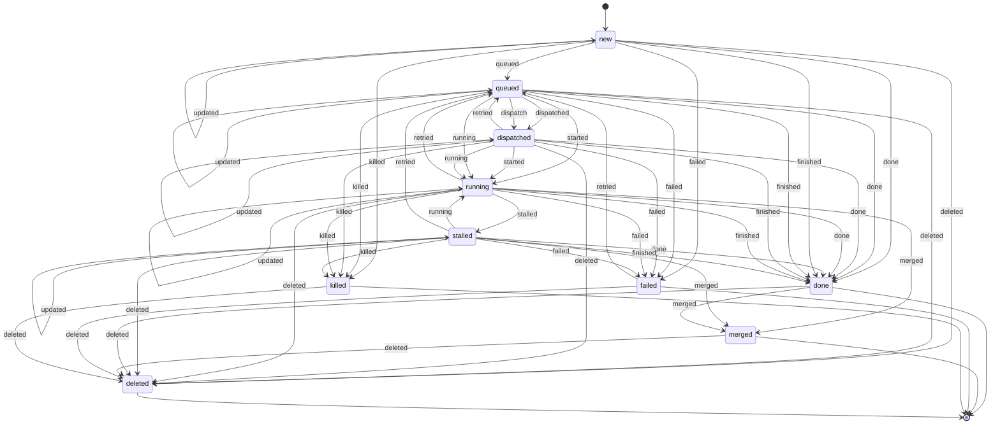

<!-- Generated by servers/_job-lifecycle.ts (renderJobLifecycleDoc). Regenerate:
     bun -e 'import { renderJobLifecycleDoc } from "./servers/_job-lifecycle.ts"; process.stdout.write(renderJobLifecycleDoc())' > docs/job-lifecycle.md -->

# Job lifecycle

Legal transitions over the event names found in `metrics/jobs.jsonl` (and the
fleet `jobs.jsonl` `state` field, which uses the same names). `applyJobEvent` in
`servers/_job-lifecycle.ts` is the adjudicator: illegal transitions are logged
no-ops, never crashes. Killed and deleted jobs reject every further event via
the `notKilled`/`notDeleted` supersession predicates; `done` still accepts
`merged` so a finished job's PR can land. Jobs may carry `parent_job_id`
(alias `parent`) naming the job that spawned them; `jobChildren` folds the
same last-wins stream into a job's live children, which is what a kill
cascade in `fleet-actions-server-handlers.ts` fans a parent kill out to.

